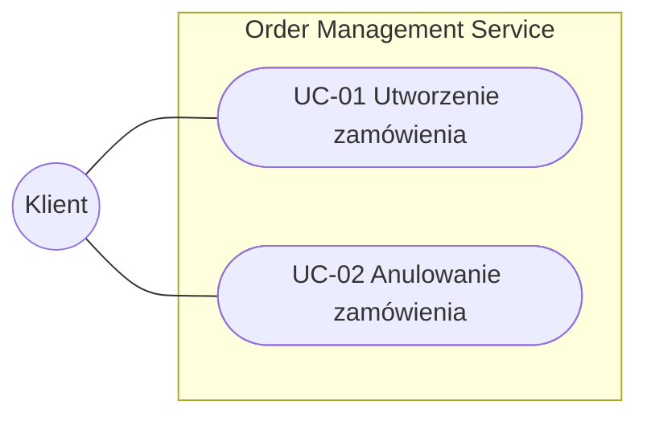

## Przypadki użycia (use-cases)

Use case (przypadek użycia) to krótki opis zachowania systemu widziany oczami użytkownika lub innego systemu, np.:
- „Klient składa zamówienie”,
- „Operator anuluje zamówienie”,
- „System wysyła powiadomienie o zmianie statusu”.

Typowy opis przypadku użycia zawiera:
- **kontekst i aktorów**,
- **scenariusz krok po kroku**,
- **warunki brzegowe i błędy**,
- **powiązane reguły biznesowe**.

W tym katalogu znajdują się scenariusze, od których startuje projektowanie funkcjonalności i architektury. Na ich podstawie powstają model domenowy, decyzje architektoniczne i implementacja w kodzie.

## Mapa przypadków użycia

