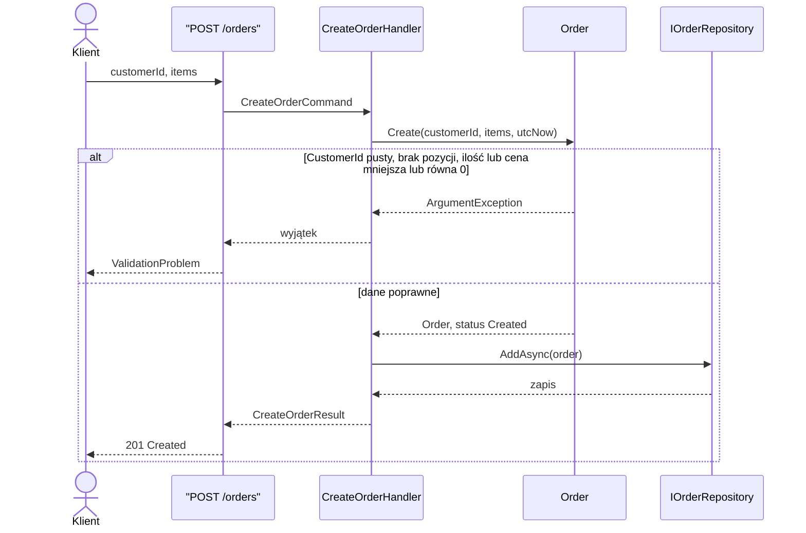

# UC-01 Utworzenie zamówienia

## Aktor

Klient

## Opis

Klient tworzy nowe zamówienie w systemie.

## Warunki wstępne

- klient przekazuje poprawny `CustomerId`,
- zamówienie zawiera co najmniej jedną pozycję,
- każda pozycja ma `ProductId`, dodatnią ilość i dodatnią cenę.

## Główny scenariusz

1. Klient wybiera produkty do zamówienia.
2. Klient wysyła żądanie utworzenia zamówienia.
3. System waliduje dane wejściowe.
4. System tworzy agregat zamówienia.
5. System zapisuje zamówienie przez repozytorium.
6. System zwraca identyfikator i status nowego zamówienia.

## Rezultat

Zamówienie zostaje zapisane w systemie ze statusem `Created`.

## Diagram sekwencji

Przepływ zaimplementowany w `POST /orders`.

## API

`POST /orders`

Przykładowe pola żądania:

- `customerId`
- `items[].productId`
- `items[].quantity`
- `items[].unitPrice`

## Uwagi

To jest przypadek użycia zaimplementowany w aktualnej wersji systemu.