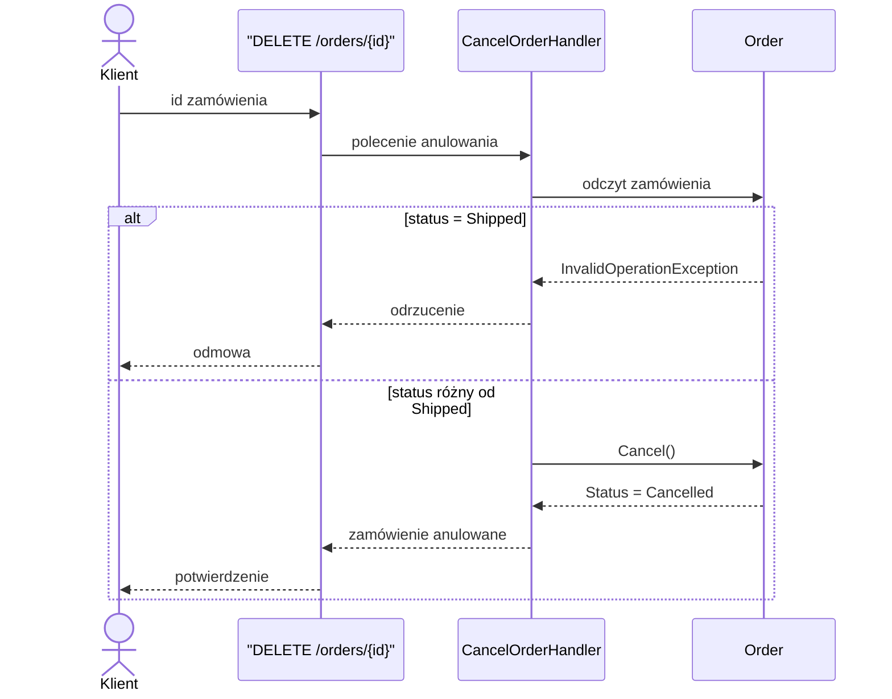

# UC-02 Anulowanie zamówienia

## Aktor

Klient

## Opis

Klient anuluje istniejące zamówienie w systemie.

## Warunki wstępne

- zamówienie istnieje w systemie,
- status zamówienia nie jest równy `Shipped`.

## Główny scenariusz

1. Klient wybiera zamówienie.
2. Klient wysyła żądanie anulowania zamówienia.
3. System odczytuje zamówienie i sprawdza jego status.
4. System zmienia status na `Cancelled`.

## Rezultat

Status zamówienia zostaje zmieniony na `Cancelled`.

## Diagram sekwencji

Docelowy przepływ anulowania. Endpoint i handler nie są jeszcze zaimplementowane. Reguła odrzucenia statusu `Shipped` jest już w `Order.Cancel()`.

## API

`DELETE /orders/{id}`

## Uwagi

Ten przypadek użycia pozostaje jako przykład kolejnego kroku rozwoju projektu. Model domenowy zawiera już regułę biznesową potrzebną do takiej funkcji, ale endpoint i przepływ aplikacyjny nie są jeszcze zaimplementowane.
